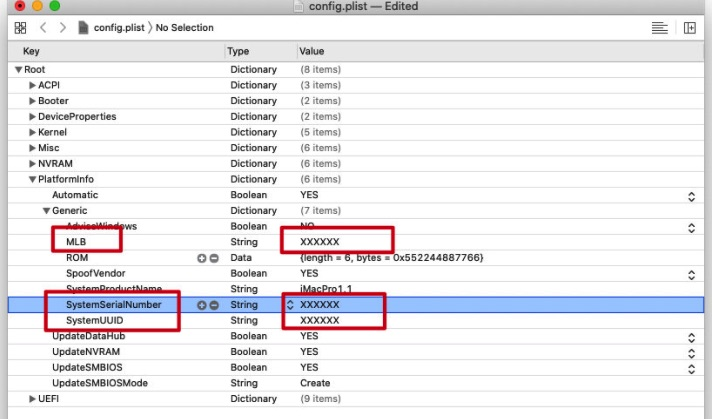

# OpenCore EFI for AMD Ryzen 9 3900X, RX 5700 XT and ASUS TUF X570

[English](README.md) | [简体中文](README_CN.md)

Created and maintained by Herman ZHAO

Contact: hermanzhaozzzz@gmail.com

Last maintained: August 12, 2026

## Release status

| Item | Version or status |
|---|---|
| OpenCore | **1.0.7 RELEASE** (`REL-107-2026-03-20`) |
| Actually tested macOS | **macOS Sequoia 15.2** |
| Required SMBIOS | **`MacPro7,1`** |

This EFI is intended for systems using the same or closely matching hardware.

## Hardware

| Component | Model |
|---|---|
| CPU | AMD Ryzen 9 3900X 3.8 GHz |
| GPU | Sapphire Radeon RX 5700 XT 8 GB NITRO+ Special Edition |
| Motherboard | ASUS TUF Gaming X570, non-Wi-Fi edition |
| Power supply | Seasonic GX750 750 W, 80 Plus Gold, fully modular |
| Case | NZXT H710i, black/red |
| CPU cooler | NZXT Kraken X73 360 mm AIO |
| Memory | Kingston DDR4, 64 GB total, 16 GB × 4, 2666 MHz |
| Windows SSD | Western Digital SN550 500 GB NVMe |
| macOS SSD | Samsung 970 EVO Plus |
| Wi-Fi / Bluetooth | Fenvi FV-T919 |
| Audio | Monitor audio over HDMI/DisplayPort; motherboard audio jacks tested working |

## Before using this EFI

- Use `config.plist` for normal booting.
- OCAuxiliaryTools is recommended for editing `config.plist`.
- Generate your own SMBIOS identity before the first boot.

> [!WARNING]
> The SMBIOS identifiers in this public repository are demonstration values.
> Generate your own Serial, MLB, SystemUUID and ROM with
> [GenSMBIOS](https://github.com/corpnewt/GenSMBIOS). Do not reuse the included
> identifiers.

## Compatibility and tested scope

### Theoretical coverage

- The bundled AMD Vanilla kernel patches cover Darwin 17 through Darwin 25,
  corresponding to macOS 10.13 High Sierra through macOS 26 Tahoe. This is the
  kernel-patch range, not a guarantee that the complete EFI works on every
  release in that range.
- With the `MacPro7,1` SMBIOS, RX 5700 XT and the current Broadcom/OCLP wireless
  stack, this repository is maintained primarily for macOS 14 Sonoma and
  macOS 15 Sequoia.
- The AMD patch limits include macOS 26 Tahoe, but the complete EFI, wireless
  root patches, USB stack and third-party Kexts have not been validated together
  on Tahoe. A direct major-version upgrade is not recommended.

### Actually validated

OpenCore 1.0.7 was booted and tested on **macOS Sequoia 15.2**. The following
items were verified after the upgrade:

- macOS and Windows boot correctly from the OpenCore picker;
- Wi-Fi and Bluetooth;
- USB 2.0 and USB 3.0;
- monitor audio over HDMI/DisplayPort and motherboard audio jacks;
- RX 5700 XT graphics acceleration;
- smooth Bilibili video playback and screen sharing.

The Realtek wired network interface was not retested for this release because
the machine currently uses Wi-Fi. macOS versions not explicitly listed above
should be treated as untested.

## macOS update policy

- Minor updates within the currently validated major version, such as macOS
  15.x updates, can normally be installed manually after creating a known-good
  EFI backup.
- A macOS update may remove the OCLP root patches. Reapply the post-install root
  patches afterward to restore Broadcom Wi-Fi support.
- Major upgrades, especially macOS 15 to macOS 26, are not recommended until
  OpenCore, AMD patches, Kexts, USB mapping and OCLP wireless patches have been
  reviewed and tested together.
- Do not leave automatic major upgrades enabled on this Hackintosh. The
  recommended tool is
  [`macupdatectl`](https://github.com/hermanzhaozzzz/.my_shell_envs/blob/main/bin/macupdatectl).
  Run it and choose **“只屏蔽大版本，保留安全更新”** (block major upgrades while
  keeping security updates). Full blocking also pauses system security-data
  updates and is therefore not the default recommendation.

## Required SMBIOS: `MacPro7,1`

This Ryzen 9 3900X and RX 5700 XT build must use **`MacPro7,1`**. Do not use
`iMac20,2`: the Ryzen 9 3900X has no integrated GPU, while an iMac SMBIOS may
expect an iGPU path for background graphics and video workloads.

On macOS 15.2, `iMac20,2` caused visible stuttering during Bilibili video
playback and screen sharing. Switching to `MacPro7,1` allowed the RX 5700 XT to
handle those workloads and removed the stuttering in testing. See
[Dortania's SMBIOS guidance](https://dortania.github.io/OpenCore-Install-Guide/extras/smbios-support.html)
for the rationale behind using an iMac Pro or Mac Pro SMBIOS on a CPU without
an iGPU.

## Working features

- AMD CPU support
- RX 5700 XT graphics acceleration
- Wi-Fi
- Bluetooth
- AirDrop
- Sleep and wake
- Monitor audio over HDMI/DisplayPort and motherboard audio jacks

## Known limitation

- Sidecar is unavailable because this CPU has no integrated graphics.
- iPhone Mirroring is unavailable.

## BIOS notes

- Enable AMD CPU virtualization if VMware is required.
- Keep FCLK at or below 1800 MHz; this machine uses 1800 MHz.
- Keep memory frequency at or below 3600 MHz; this machine currently uses
  2666 MHz.

## Wi-Fi and Bluetooth after installation

After the first successful macOS login, Wi-Fi and Bluetooth may still be
unavailable. Install
[OpenCore Legacy Patcher](https://dortania.github.io/OpenCore-Legacy-Patcher/),
run **Post-Install Root Patch**, and reboot.

## Extra Tutorials and Resources

- [LiquidBar](https://github.com/hermanzhaozzzz/LiquidBar) — a utility I developed
  to control NZXT case fans and liquid-cooling pump power while monitoring
  temperatures. It is strongly recommended for users with the same NZXT case
  and liquid cooler.

- [Use the RX 5700 XT from PyTorch through MPS/Metal](tutorial_pytorch-via-this_AMD5700xtGPU/README.md) —
  tested `uv` and Conda installation, minimal GPU verification, a performance
  check and measured results.

## Support this project

Preparing, updating and thoroughly testing this EFI and its tutorials takes
considerable time and effort. If this project has helped you, please consider
buying me a coffee. Support is entirely optional, and your encouragement is
sincerely appreciated. Thank you!

| Alipay | WeChat Pay |
|:---:|:---:|
|  |  |
